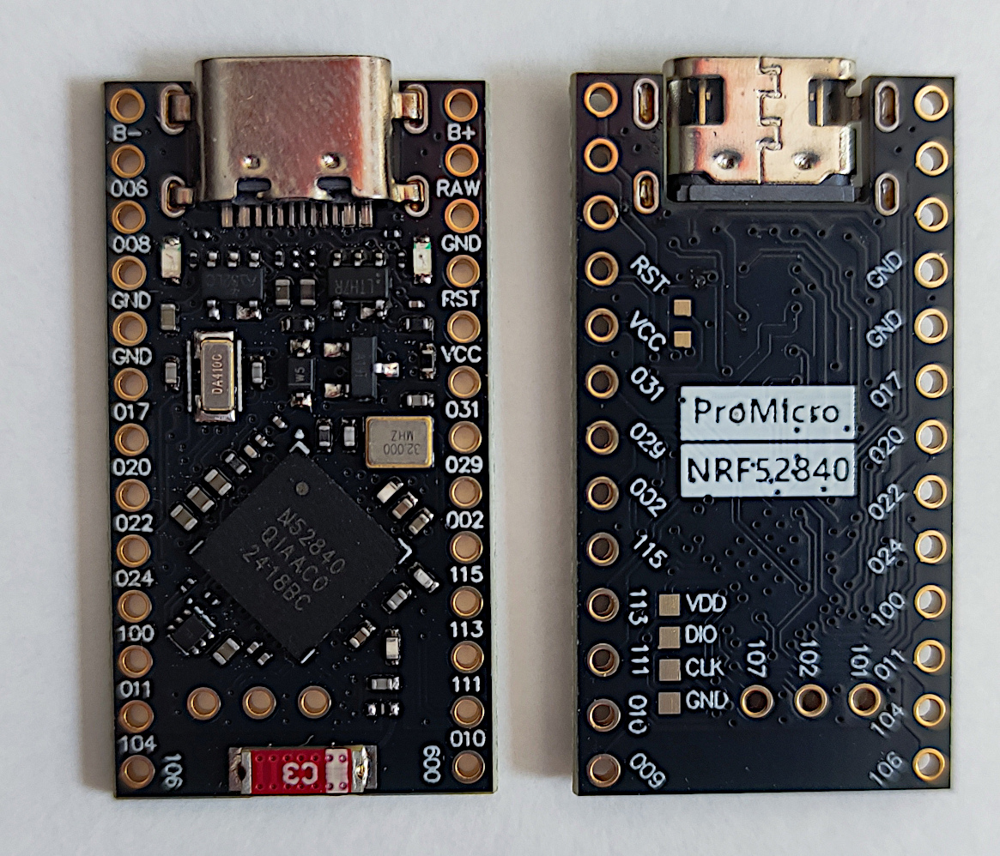
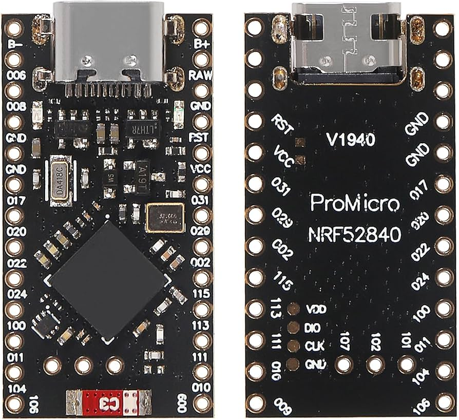
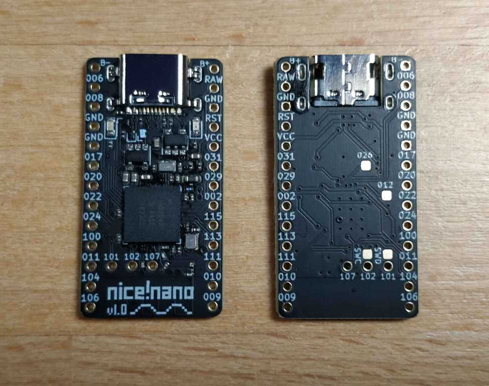

# nRF52840 Hello World

Template dasar PlatformIO untuk memulai pemrograman board **nRF52840 Pro Micro / SuperMini** dengan framework Arduino. Program contoh membuka USB CDC Serial pada baud rate `115200`, mencetak identitas board satu kali, lalu mencetak `Hello World!` setiap satu detik.

## Board yang digunakan

| nRF52840 Pro Micro / SuperMini | Tampak depan dan belakang | nice!nano (board sejenis) |
| :---: | :---: | :---: |
|  |  |  |

> [!NOTE]
> Foto menunjukkan beberapa varian board berbasis nRF52840 dengan bentuk dan susunan pin yang serupa. Selalu periksa label pin yang tercetak pada board sebelum menyambungkan daya atau periferal.

## Kebutuhan

- Visual Studio Code dengan ekstensi PlatformIO IDE, atau PlatformIO Core (CLI).
- Python 3 yang dapat dipanggil dengan perintah `python`.
- Paket Python `pyserial` dan `adafruit-nrfutil` untuk upload melalui serial DFU.
- Board nRF52840 yang sudah memiliki bootloader kompatibel Adafruit nRF52/UF2.
- Kabel USB yang mendukung transfer data.

Instal dependensi Python jika belum tersedia:

```bash
python -m pip install pyserial adafruit-nrfutil
```

## Struktur file wajib

File dan folder berikut harus tetap tersedia agar template dapat di-build dan di-upload dengan konfigurasi bawaan:

```text
.
├── platformio.ini
├── boards/
│   ├── nrf52840_pro_micro.json
│   ├── nRF52840-clones.jpg
│   ├── nRF52840-clones-2.jpg
│   └── nicenano.jpg
├── scripts/
│   ├── generate_uf2.py
│   ├── upload_uf2.py
│   ├── uf2conv.py
│   └── uf2families.json
└── src/
    └── main.cpp
```

Keterangan:

- `platformio.ini` — konfigurasi board, framework, build, serial monitor, dan proses upload.
- `boards/nrf52840_pro_micro.json` — definisi board kustom yang dibaca PlatformIO.
- `src/main.cpp` — program utama; file inilah yang biasanya dikembangkan.
- `scripts/generate_uf2.py` — membuat `.pio/build/nrf52840_pro_micro/firmware.uf2` setelah build.
- `scripts/upload_uf2.py` — membuat paket DFU dan meng-upload firmware melalui port serial.
- `scripts/uf2conv.py` dan `scripts/uf2families.json` — konverter UF2 beserta daftar family ID perangkat.

Folder `include/`, `lib/`, dan `test/` mengikuti struktur standar PlatformIO. Ketiganya boleh tetap kosong sampai dibutuhkan. Folder `.pio/` tidak perlu dimasukkan ke repository karena berisi hasil build yang dapat dibuat ulang.

## Bagian yang tidak boleh dimodifikasi

Untuk mempertahankan kompatibilitas template ini, jangan mengubah atau menghapus:

- Seluruh isi `boards/nrf52840_pro_micro.json`, kecuali Anda memang sedang membuat definisi untuk varian hardware lain.
- File `scripts/generate_uf2.py`, `scripts/upload_uf2.py`, `scripts/uf2conv.py`, dan `scripts/uf2families.json`.
- Nilai berikut di `platformio.ini`:

  ```ini
  [env:nrf52840_pro_micro]
  platform = nordicnrf52
  board = nrf52840_pro_micro
  framework = arduino
  build_flags =
      -DUSE_TINYUSB
  extra_scripts = post:scripts/generate_uf2.py
  upload_protocol = custom
  upload_command = python scripts/upload_uf2.py "$BUILD_DIR"
  ```

- Inisialisasi USB Serial berikut di `src/main.cpp` apabila output masih ingin dikirim melalui USB CDC:

  ```cpp
  Serial.begin(115200);
  while (!Serial) {
      delay(10);
  }
  ```

Bagian yang **boleh disesuaikan**:

- Isi `setup()` dan `loop()` setelah blok inisialisasi Serial.
- `monitor_port = COM7` di `platformio.ini`; ganti `COM7` sesuai port board pada komputer Anda, atau hapus baris tersebut agar PlatformIO mencoba mendeteksi port secara otomatis.
- `monitor_speed`, asalkan nilainya juga disamakan dengan argumen `Serial.begin(...)`.
- Dependensi library tambahan melalui `lib_deps` di `platformio.ini`.

## Build dan upload

1. Hubungkan board menggunakan kabel USB data.
2. Buka folder proyek ini di Visual Studio Code dengan PlatformIO.
3. Build firmware:

   ```bash
   pio run
   ```

4. Upload firmware:

   ```bash
   pio run --target upload
   ```

Skrip upload akan mencoba menemukan board, mengirim sinyal reset `1200 baud` bila diperlukan, membuat `firmware.zip`, lalu melakukan flashing melalui serial DFU. Jika board tidak masuk bootloader secara otomatis, tekan tombol **Reset dua kali dengan cepat**, lalu jalankan upload kembali.

Build juga menghasilkan file berikut:

```text
.pio/build/nrf52840_pro_micro/firmware.bin
.pio/build/nrf52840_pro_micro/firmware.uf2
```

File `firmware.uf2` dapat disalin secara manual ke drive bootloader UF2 jika diperlukan.

## Serial monitor dan output

Buka serial monitor pada baud rate `115200`:

```bash
pio device monitor --baud 115200
```

Jika upload berhasil dan koneksi USB Serial sudah terbuka, outputnya adalah:

```text
nRF52840 USB CDC Serial Test
Hello World!
Hello World!
Hello World!
...
```

Baris pertama dicetak satu kali saat board mulai berjalan. Baris `Hello World!` berikutnya dicetak setiap satu detik.

> [!TIP]
> Program menunggu USB Serial tersambung pada `while (!Serial)`. Karena itu, output baru dimulai setelah serial monitor dibuka.
